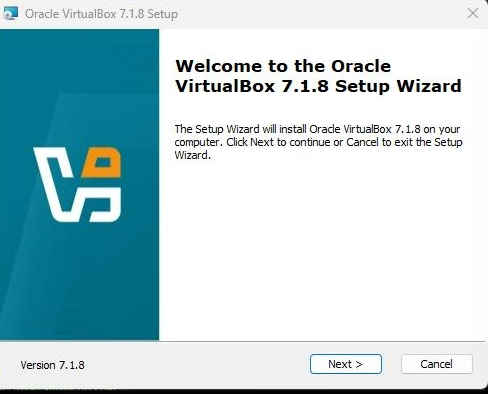
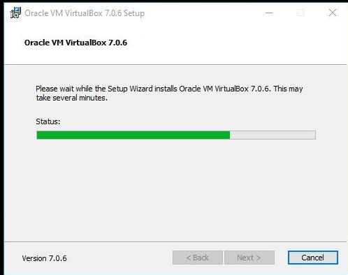
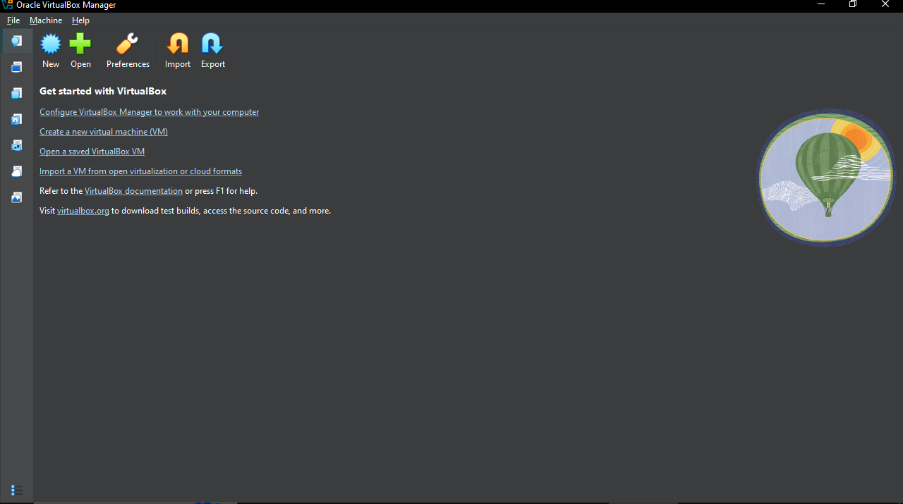
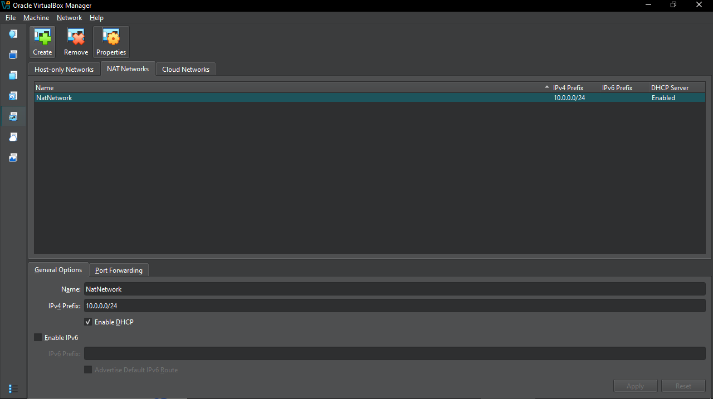
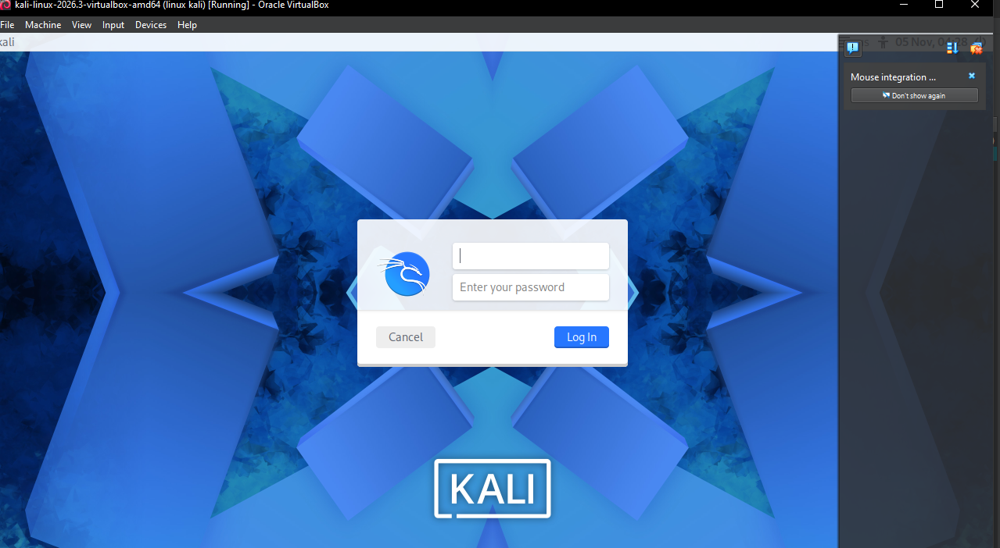

# NETWORKWALKS-B082-WK1-PM1-CYBERSECURITY-LAB-SETUP
# NETWORKWALKS CYBERSECURITY LAB SETUP

1. Project Overview

This project is part of the Networkwalks Cybersecurity Program. The objective was to establish a cybersecurity laboratory environment by installing Oracle VirtualBox and setting up Kali Linux as a virtual machine.

The project provides practical experience with virtualization, software installation, virtual machine configuration and Linux operating system navigation.

2. Project Objectives

Understand virtualization.

Download and install Oracle VirtualBox.

Create and configure a Kali Linux virtual machine.

Start and access Kali Linux.

Explore the Kali Linux desktop and terminal.

Develop technical and troubleshooting skills.

Document practical work using GitHub.

3. Tools and Technologies

Oracle VirtualBox

Kali Linux

Windows Operating System

GitHub

4. Project Implementation

Step 1: Downloading Oracle VirtualBox

Oracle VirtualBox was downloaded from the official website to provide a virtualization platform for running Kali Linux.

Official website: https://www.virtualbox.org/

Step 2: Installing Oracle VirtualBox

After downloading the installer, Oracle VirtualBox was installed on the Windows host computer by following the installation wizard.

Step 3: Opening Oracle VirtualBox Manager

After installation, Oracle VirtualBox Manager was opened to create and manage the Kali Linux virtual machine.

Step 4: Configuring the Virtual Machine

The Kali Linux virtual machine settings were reviewed and configured to allocate the necessary system resources.

Step 5: Starting Kali Linux

The Kali Linux virtual machine was started through Oracle VirtualBox.

The login screen confirmed that the virtual machine had started successfully.

Step 6: Accessing the Kali Linux Desktop

After successfully logging in, the Kali Linux desktop environment was accessed.

Step 7: Checking System Information

The Kali Linux terminal was used to explore system information and become familiar with the Linux command-line environment.

Step 8: Final Cybersecurity Lab Environment

The final result demonstrates Kali Linux running inside Oracle VirtualBox as a virtual cybersecurity learning environment.

5. Challenges and Troubleshooting

During the setup process, understanding the virtual machine environment and its configuration was an important part of the practical work.

The virtual machine settings were reviewed to ensure that Kali Linux could start successfully.

6. Skills and Knowledge Gained

Through this project, I gained practical experience in:

Downloading and installing Oracle VirtualBox.

Understanding virtualization.

Creating and managing virtual machines.

Configuring virtual machine resources.

Running Kali Linux.

Navigating the Linux desktop.

Using the Linux terminal.

Documenting technical projects using GitHub.

Troubleshooting basic setup issues.

7. Conclusion

The Cybersecurity Lab Setup project provided valuable practical experience in establishing a virtual cybersecurity environment.

Installing Oracle VirtualBox and successfully running Kali Linux improved my understanding of virtualization and introduced me to the Linux environment used in cybersecurity learning.

This project represents an important step in developing my technical knowledge and practical cybersecurity skills.

Program: Networkwalks Cybersecurity Program

Project: Cybersecurity Lab Setup

Week: 1

Tools: Oracle VirtualBox and Kali Linux

Host Operating System: Windows

Purpose: Educational cybersecurity practical work.
